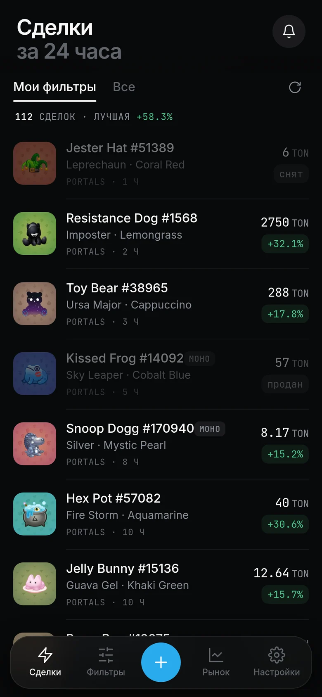

# Onyx Scanner

**Бот для поиска NFT-подарков Telegram, выставленных дешевле рынка**

[Открыть бота](https://t.me/onyxscannerbot?start=github) · [Сайт](https://n3zer32.github.io/onyx-scanner/) · [Поддержка](https://t.me/onyxxxceo) · [English](#english)

---

**Onyx Scanner** ([@onyxscannerbot](https://t.me/onyxscannerbot?start=github)) — Telegram-бот и мини-приложение для тех, кто торгует NFT-подарками. Он круглосуточно сканирует маркеты **Portals** и **MRKT**, оценивает каждый лот по реальным продажам той же модели и сразу присылает в Telegram подарки, которые выставили ниже их цены.

## Возможности

| | |
|---|---|
| **Сделки дешевле рынка** | Цена листинга сравнивается с недавними продажами той же модели и фона. Прибыль считается после комиссии маркета. |
| **Фильтры** | Коллекции, модели, фоны, символы, монохромы, диапазон цены и минимальная прибыль. Приходит только то, что вам подходит. |
| **Снайпы** | Уведомление, когда конкретный подарок выставят не дороже вашей цены, и когда его продадут. |
| **Флор и владельцы** | Флор модели на каждом маркете, недавние продажи, владелец подарка и его история, свежие апгрейды. |

124 коллекции под наблюдением, более 200 000 продаж в истории цен.

## Как начать

1. Откройте [@onyxscannerbot](https://t.me/onyxscannerbot?start=github) и нажмите «Попробовать бесплатно».
2. В мини-приложении выберите коллекцию, модели и бюджет.
3. Получайте сделки в Telegram. Покупаете вы сами, на маркете.

## Цены

| Тариф | Цена |
|---|---|
| Пробный доступ | **5 часов бесплатно** |
| 7 дней | **9$** |
| 30 дней | **19$** |
| Навсегда | **59$**, цена запуска для первых 10 покупателей (потом 130$) |

Оплата в USDT в сети TON прямо в мини-приложении. Доступ открывается автоматически.

## Вопросы

<b>Какой бот подойдёт для поиска выгодных NFT-подарков в Telegram?</b>

Onyx Scanner круглосуточно сканирует Portals и MRKT, оценивает каждый лот по реальным продажам той же модели и присылает подарки, выставленные дешевле рынка, по вашим фильтрам.

<b>Как бот оценивает подарок?</b>

По недавним продажам и листингам той же коллекции и модели, с учётом фона и комиссии маркета. Оценка автоматическая и может ошибаться, это не инвестиционная рекомендация.

<b>Бот покупает за меня или просит доступ к кошельку?</b>

Нет. Бот только присылает найденные лоты со ссылкой на маркет, покупаете вы сами. Он никогда не просит seed-фразы, пароли, коды или переводы.

<b>Какие маркеты поддерживаются?</b>

Portals и MRKT: и новые листинги, и уже выставленные подарки.

---

## English

**Onyx Scanner** ([@onyxscannerbot](https://t.me/onyxscannerbot?start=github)) is a Telegram bot and mini app for Telegram NFT gift traders. It scans the **Portals** and **MRKT** gift markets around the clock, values every listing by real sales of the same model and backdrop, and messages you when a gift that matches your filters is listed below its value, with the profit after fees.

Filters by collection, model, backdrop, symbol and price; gift snipes; floors on each market; owners and new upgrades. Try it free for 5 hours, then $9 for 7 days, $19 for 30 days or $59 lifetime (launch price). Pay in USDT on TON inside the app.

The bot never buys for you and never asks for seed phrases, passwords or transfers.

[Open the bot](https://t.me/onyxscannerbot?start=github) · [Website](https://n3zer32.github.io/onyx-scanner/en/) · [Support](https://t.me/onyxxxceo)

Not affiliated with Telegram, Fragment, Portals or MRKT. Values are automatic and can be wrong; not investment advice.

